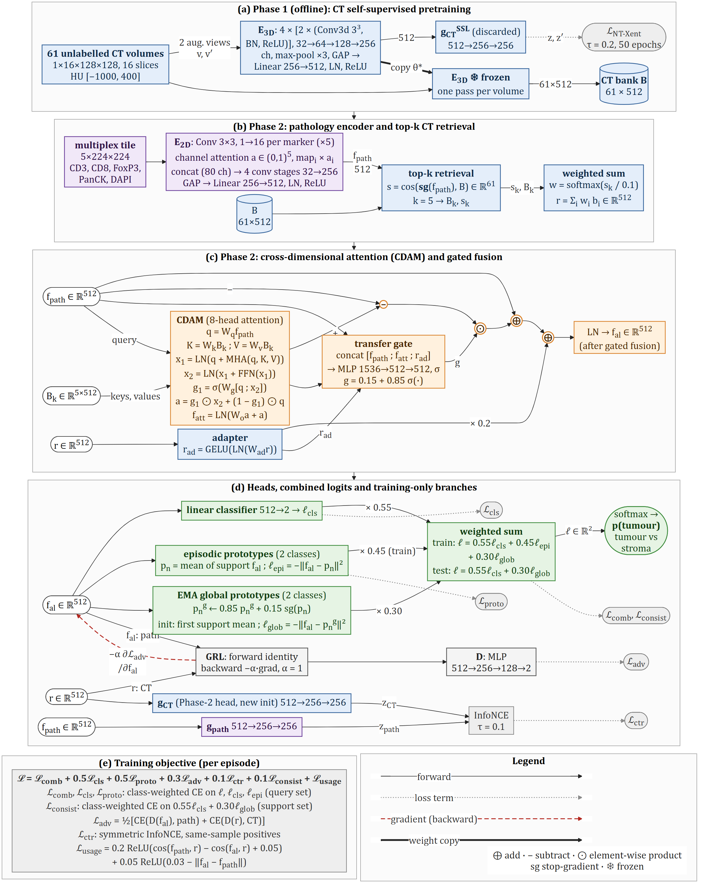
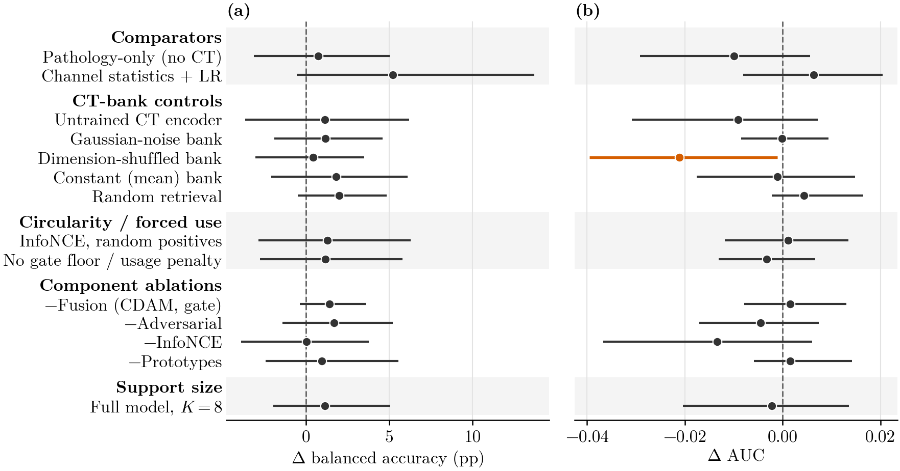
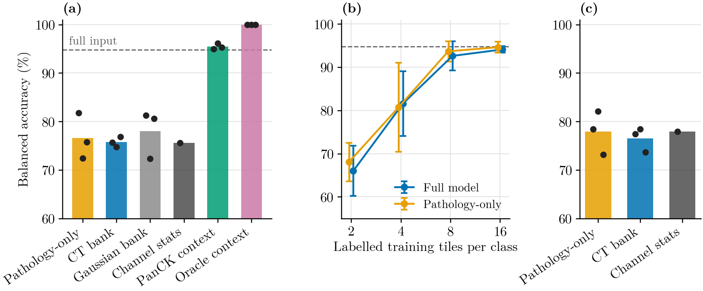

# Does unpaired 3D CT context help few-shot multiplex pathology classification?

Code and results for a controlled feasibility study of **unpaired cross-dimensional transfer**: a bank of self-supervised 3D CT descriptors is retrieved and fused into an episodic classifier for 2D multiplex immunofluorescence (mIF) pathology tiles, and a set of controls tests whether the model actually uses that context.

**Main finding.** The complete pipeline trains stably and generalizes to held-out patients (balanced accuracy 94.0%, AUC 0.989), but an identically trained pathology-only model performs comparably, and the predictions barely change when the CT bank is replaced by noise, a constant vector or random retrieval. The CT context also gives no benefit when the dominant PanCK channel is removed, when tumour core is classified against tumour margin, or with only 2 to 16 labelled tiles per class. A positive control shows that the same fusion pathway does use context when it is informative: with PanCK removed, feeding each tile's own PanCK statistics as the context raises balanced accuracy from 76.6% to 95.5%. In this setting the CT context can be integrated, but it contributes no detectable information.



## Study at a glance

| | |
|---|---|
| Source domain | LungCT-Diagnosis (TCIA): 61 unlabelled thoracic CT series, one per patient |
| Target domain | HNSCC-mIF-mIHC-comparison (TCIA): 8 head and neck squamous cell carcinoma patients, 5 mIF channels (CD3, CD8, FoxP3, PanCK, DAPI) |
| Task | Tumour core versus stroma, using the pathologist-selected region types (94 / 78 tiles; margin tiles excluded). Secondary task: tumour core versus margin (94 / 96 tiles) |
| Protocol | Leave-one-patient-out cross-validation, 3 seeds, pooled out-of-fold predictions, patient-level cluster bootstrap CIs |
| Scale | Groups A to C: 464 training runs and 7 SSL pretraining runs, about 3 h on 2 x NVIDIA T4. Group D: 696 training runs and 3 SSL pretraining runs, about 3.7 h |

## Results

### Main comparison

Leave-one-patient-out results on 172 tiles (mean ± SD over three seeds; 95% CI from a patient-level cluster bootstrap):

| Model | Balanced accuracy (%) | 95% CI | AUC | 95% CI |
|---|---:|---:|---:|---:|
| Full model (CT context), K = 2 | 94.0 ± 1.2 | 90.3 to 97.4 | 0.989 ± 0.001 | 0.975 to 0.998 |
| Pathology-only, K = 2 | 94.8 ± 0.6 | 90.7 to 98.4 | 0.979 ± 0.006 | 0.952 to 0.998 |
| Full model, K = 8 | 95.2 ± 2.5 | 92.9 to 97.8 | 0.987 ± 0.010 | 0.971 to 0.998 |
| Pathology-only, K = 8 | 95.1 ± 1.1 | 91.2 to 98.9 | 0.984 ± 0.011 | 0.968 to 0.999 |
| Channel statistics + logistic regression | 98.1 | 95.1 to 100.0 | 0.996 | 0.983 to 1.000 |

Controls and ablations, as paired differences from the full model. Replacing the CT bank with an untrained encoder, Gaussian noise, a dimension-shuffled or constant bank, or retrieving at random, does not change performance; only one of the 24 intervals excludes zero (a small AUC drop for the dimension-shuffled bank, -0.021), which is consistent with chance at this number of comparisons:



### Harder tasks, annotation budgets and positive controls

Because PanCK alone nearly separates tumour core from stroma (AUC 0.998), the main task leaves little room for any auxiliary signal. Group D repeats the comparison where there is room for improvement. Δ is the paired difference from the pathology-only model of the same setting (for the budgets: full minus pathology-only at the same budget), with 95% patient-level bootstrap CIs:

| Setting | Model | Balanced accuracy (%) | Δ balanced accuracy (pp) |
|---|---|---:|---:|
| PanCK removed | Pathology-only | 76.6 ± 4.8 | reference |
| | Full model (CT bank) | 75.8 ± 1.1 | -0.9 [-6.1, +6.3] |
| | Gaussian-noise bank | 78.1 ± 5.0 | +1.4 [-1.7, +5.8] |
| PanCK removed, positive controls | PanCK-statistics context | 95.5 ± 0.6 | +18.9 [+10.5, +27.5] |
| | Oracle context (label-encoding) | 100.0 ± 0.0 | +23.4 [+13.7, +32.0] |
| Tumour core vs margin | Pathology-only | 77.9 ± 4.5 | reference |
| | Full model (CT bank) | 76.5 ± 2.5 | -1.4 [-3.8, +1.2] |
| Annotation budget (full / pathology-only) | 2 tiles per class | 66.0 / 68.1 | -2.1 [-6.8, +3.8] |
| | 4 tiles per class | 81.6 / 80.7 | +0.9 [-5.7, +8.2] |
| | 8 tiles per class | 92.6 / 93.7 | -1.1 [-2.9, +0.4] |
| | 16 tiles per class | 94.1 / 94.6 | -0.5 [-2.9, +2.0] |

The positive controls bypass retrieval and feed a context vector through the same fusion pathway. The PanCK-statistics context recovers almost all of the accuracy lost without PanCK, so the architecture can exploit an informative context; the absence of an effect of the CT context reflects what is in the CT bank. Channel-statistics baselines reach 75.6% without PanCK and 77.9% on tumour core versus margin.



### Sensitivity and diagnostics

- **Labelled data.** The episodic support size K describes episodes, not the annotation budget: each fold trains on 124 to 136 unique labelled tiles (mean 129), and the validation patient adds 15 to 24 tiles for checkpoint selection. The budget conditions above restrict the training pool itself.
- **Extended bank swap.** Swapping the bank of the trained group D reference models at test time changes the total logit margin by 5 to 6% of its typical size and keeps the fused features nearly parallel (mean cosine 0.983 to 0.993); only 2 to 7 of 516 decisions flip (Cohen's kappa 0.973 to 0.992).
- **Retrieval null.** The label/top-1 retrieval mutual information of the full model (0.315 nats) is matched by models trained with replacement banks or random retrieval (0.244 to 0.379 nats), so the apparent class dependence of retrieval comes from the pathology features. A probe on the retrieved context alone stays below chance (AUC 0.36).
- **Patients and checkpoint selection.** Leaving out each patient in turn moves the full minus pathology-only difference only within -1.9 to +1.0 pp. With the previous patient as validation patient the full model is 2.5 pp better ([+0.1, +5.6]); with last-epoch selection it is 1.5 pp worse ([-3.1, +0.1]). The opposite signs do not indicate an effect of the CT context.
- **Channels and preprocessing.** With three seeds, removing PanCK lowers balanced accuracy by 19.0 pp ([-29.6, -8.7]); removing CD3, CD8 or FoxP3 has no detectable effect, and removing DAPI slightly helps. Without the DAPI-derived region mask the full model is 4.4 pp below pathology-only ([-9.0, -0.8]).

### Where to find each result

All tables and figures are generated from the saved outputs in [`results/`](results/):

| What | Table | Figure |
|---|---|---|
| Main results, per-patient results, pooled confusion counts | `main_results`, `per_patient`, `confusion_pooled` | `roc_pooled`, `reliability_main` |
| CT-bank controls and ablations | `controls_ablations` | `forest_controls` |
| Test-time bank swap | `bank_swap`; `analysis/bank_swap_extended` | |
| Retrieval and alignment diagnostics | `retrieval_diagnostics`; `analysis/retrieval_null`, `analysis/retrieval_per_patient` | `bank_usage_main`, `attention_gate_hist`, `tsne_main` |
| SSL convergence and sensitivity | `ssl_sensitivity` | `ssl_convergence` |
| Channel drop and label audit | `channel_drop`, `label_audit`, `single_channel_auc` | |
| Harder tasks, positive controls, budgets | `analysis/paired_differences`, `analysis/baselines_group_d`, `analysis/labelled_tiles` | `harder_tasks` |
| Patient, selection, mask and channel sensitivity | `analysis/jackknife`, `analysis/per_patient_difference`, `analysis/paired_differences` | |

Tables of groups A to C are in [`results/aggregate/tables/`](results/aggregate/tables/), those of group D in [`results/group_d/aggregate/tables/`](results/group_d/aggregate/tables/) (CSV and LaTeX), and the post-hoc analyses in [`results/analysis/`](results/analysis/). Figures are in [`docs/figures/`](docs/figures/) (PDF and PNG). The paper is currently under review and will be linked here once published.

## Repository structure

```text
main.py                 Experiment pipeline: data loading, SSL pretraining, episodic training,
                        all conditions and controls (groups A to D), multi-GPU launcher, aggregation
scripts/
  analysis.py           Post-hoc analyses from the saved runs (paired differences, extended
                        bank swap, retrieval null, jackknife, labelled-tile counts)
  make_figures.py       Regenerates every data figure in docs/figures/ from results/
  fonts/                Latin Modern Roman fonts used by the figures
docs/
  DATA.md               Datasets, labels, the label audit and ethics
  REPRODUCING.md        Step-by-step reproduction (local and Kaggle)
  architecture/         Mermaid source and rendered architecture figure
  figures/              Result figures (PDF and PNG)
results/
  README.md             Layout of the saved outputs, conditions and the result.json schema
  runs/                 Groups A to C: one result.json per condition, seed and fold
  ssl/, banks/, logs/   SSL training histories, CT feature banks of the main model, worker logs
  aggregate/            Groups A to C: tables (CSV, LaTeX) and summary.json
  group_d/              Group D: runs, SSL histories, banks, logs and aggregate, same layout
  analysis/             Post-hoc analyses (CSV) and analysis_summary.json
CHANGELOG.md            Version history
CITATION.cff            Citation metadata
```

## Quick start

```bash
git clone https://github.com/zulqarnainalipk/ct-to-pathology-transfer.git
cd ct-to-pathology-transfer
python -m venv .venv && source .venv/bin/activate      # Windows: .venv\Scripts\activate
pip install -r requirements.txt

python main.py --list                                   # conditions and run counts per group
python main.py --run smoke --ct_dir PATH/TO/LungCT-Diagnosis --path_dir "PATH/TO/PKG - HNSCC-mIF-mIHC"
```

The smoke test runs every condition on a tiny subset on the CPU. The datasets are not included; see [`docs/DATA.md`](docs/DATA.md) for download and folder layout, and [`docs/REPRODUCING.md`](docs/REPRODUCING.md) for the full runs, the multi-GPU launcher and the aggregation.

The experiments are split into independent groups that can run in separate sessions:

```bash
python main.py --run ABC --ct_dir ... --path_dir ... --out results_run      # groups A to C (464 runs)
python main.py --run D   --ct_dir ... --path_dir ... --out results_run_d    # group D (696 runs)
```

To rebuild the tables, analyses and figures from the saved outputs without training anything:

```bash
python main.py --aggregate results --agg_out results/aggregate
python main.py --aggregate results/group_d --agg_out results/group_d/aggregate
python scripts/analysis.py
python scripts/make_figures.py
```

## Version history

Version 3.0 is the current version. It adds the group D experiments (harder tasks, positive controls, annotation budgets, selection and preprocessing variants, three-seed channel drop, extended bank swap) and the post-hoc analyses; the results of groups A to C are unchanged from version 2.0. Version 1.0 (commit `dd45c1d`) accompanied the originally submitted manuscript; its results are withdrawn because of errors in the cohort description, the label definition, the CT preprocessing and the optimizer set-up. [`CHANGELOG.md`](CHANGELOG.md) lists the changes of each version.

## Citation

If you use this code or the control protocol, please cite the paper (manuscript under review). Citation metadata is in [`CITATION.cff`](CITATION.cff).

```text
Ali, Z. Does Unpaired 3D CT Context Help Few-Shot Multiplex Pathology Classification?
A Controlled Feasibility Study. Manuscript under review, 2026.
```

The datasets should be cited as described on their TCIA collection pages (see [`docs/DATA.md`](docs/DATA.md)).

## Author

**Zulqarnain Ali**  
Department of Data Science, The Islamia University of Bahawalpur  
Email: [zulqar445ali@gmail.com](mailto:zulqar445ali@gmail.com)  
Website: [zulqarnainali.com](https://zulqarnainali.com)  
GitHub: [github.com/zulqarnainalipk](https://github.com/zulqarnainalipk)  
LinkedIn: [linkedin.com/in/zulqarnainalipk](https://linkedin.com/in/zulqarnainalipk)  
ORCID: [0009-0009-0281-882X](https://orcid.org/0009-0009-0281-882X)

## License

The code is released under the MIT License. The datasets are distributed by TCIA under their own data-use terms and are not part of this repository.
