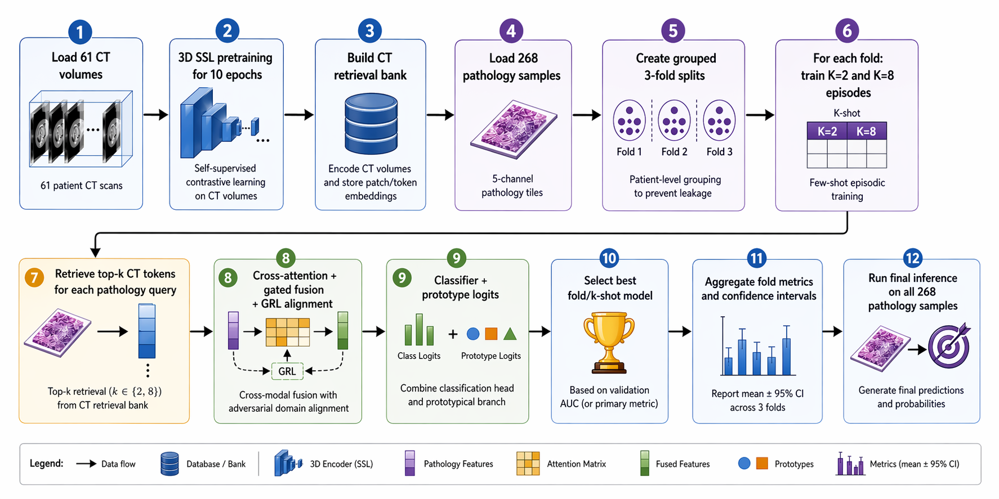
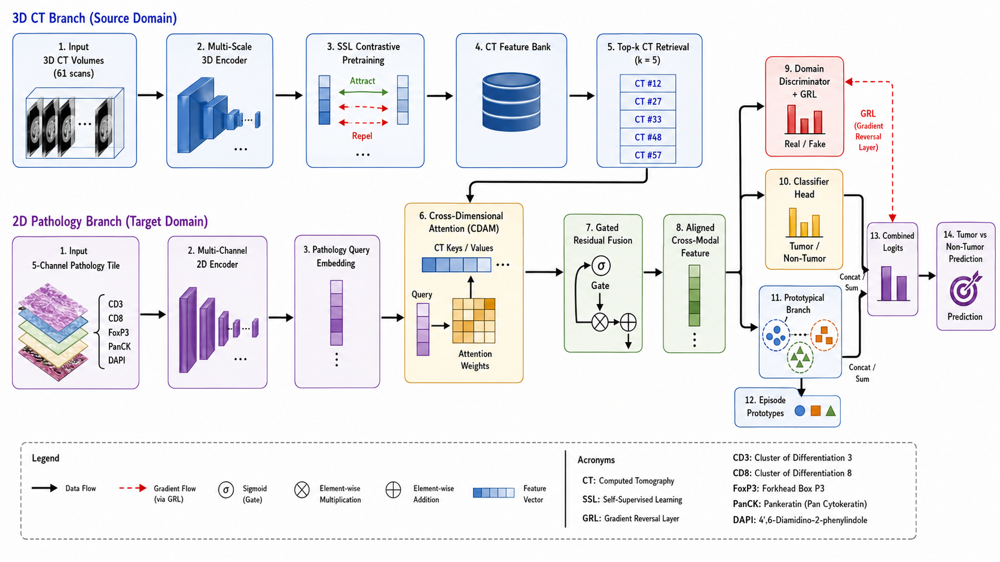
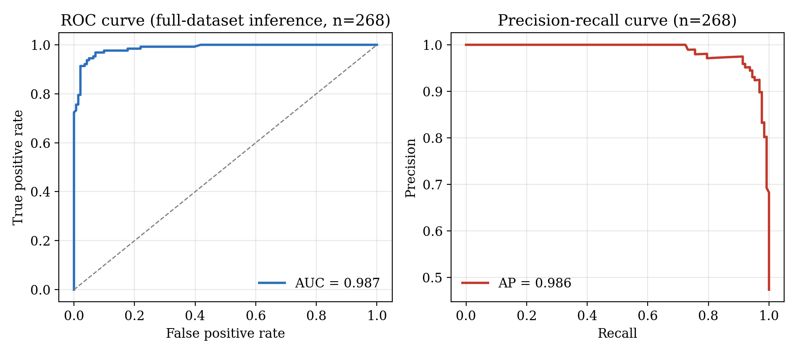
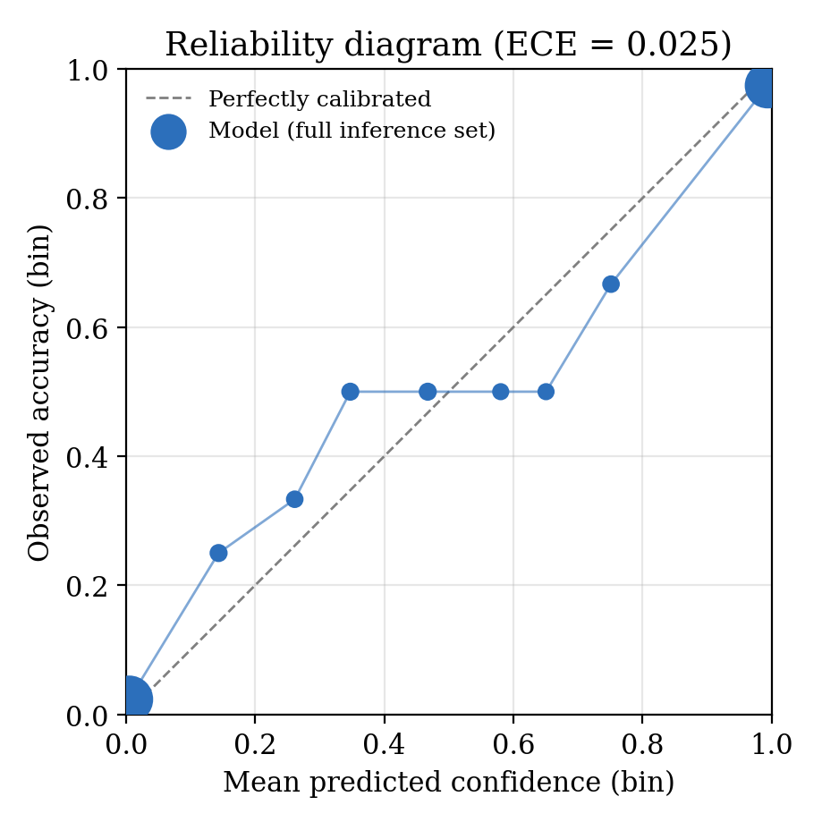

# Cross-Dimensional Episodic Transfer: CT to Few-Shot Pathology Classification

Code and experiment outputs for *"Can a CT Scan Teach a Pathology Classifier?
Cross-Dimensional Episodic Transfer from 3D Radiology to Few-Shot 2D
Histopathology."* The full write-up (methodology, results, statistical
analysis, and an explicit Limitations section) is in
[`docs/paper.pdf`](docs/paper.pdf).

This repository contains the exact training/evaluation code used to produce
the numbers in the paper, split into readable modules, plus the saved
experiment outputs (metrics, logs, plots, per-fold predictions) needed to
reproduce every number and figure in the Results section.

## What this is

A pathology classifier for head-and-neck squamous cell carcinoma (HNSCC)
tissue tiles that is given access, at inference time, to a bank of features
extracted from an unrelated, unlabeled collection of lung CT volumes. A 3D CT
encoder is pretrained with contrastive self-supervision, frozen, and used to
build a static feature bank; a 2D pathology encoder then retrieves the top-`k`
most similar CT feature vectors for each pathology query and fuses them in
through a cross-dimensional attention bridge (CDAM), a domain-adversarial
alignment loss, and a prototypical few-shot classification head.

<p align="center">
  
</p>

<p align="center">
  
</p>

## Results (grouped 3-fold cross-validation, 268 pathology samples / 42 patients)

| Metric | Mean | 95% CI |
|---|---|---|
| Accuracy | 88.66% | [87.69%, 89.52%] |
| Balanced accuracy | 88.26% | [87.92%, 88.78%] |
| F1 (macro) | 0.884 | — |
| AUC-ROC | 0.970 | [0.967, 0.973] |
| Cohen's κ | 0.769 | [0.755, 0.778] |
| MCC | 0.777 | — |

<p align="center">
  
  
</p>

The reliability diagram above is intentionally included even though it shows
a **negative** result: the model is measurably overconfident on held-out data
(ECE ≈ 0.29) despite discriminating well. This and every other limitation
(no post-hoc calibration applied, single-seed point estimate for the primary
run, weak threshold-derived labels, small target dataset, etc.) is discussed
in full in `docs/paper.pdf`, Limitations section — please read it before
citing or building on these results.

## Repository structure

```
main.py            entry point -- run this (python main.py)
config.py          ResearchConfig dataclass: every hyperparameter
utils.py           seeding, logging, CI/bootstrap math, InfoNCE loss,
                    CT-feature retrieval, grouped CV splitting, fold manifests
datasets.py         CT3DVolumeDataset, PathologyMultiChannelDataset, augmentations
models.py           3D/2D encoders, CDAM, gradient-reversal discriminator,
                    prototypical network, CrossDomainTransferModel
training.py         CT SSL pretraining, pathology SSL control, episodic
                    meta-learning training loop
evaluation.py       per-fold evaluation, full-dataset inference
analysis.py         metrics, ablation runner, calibration/clinical metrics,
                    robustness/interpretability analysis, report generation
visualization.py    all matplotlib/seaborn figure generation

docs/
  paper.pdf          full paper (methodology, results, limitations, references)
  figures/           key figures also embedded above

outputs/             saved artifacts from the run reported in the paper
  final_results.json           aggregated cross-validation metrics + 95% CIs
  analysis/fold_{0,1,2}/        per-fold results.json + manifest.json (patient IDs per split)
  inference/                    full-dataset inference CSV + summary JSON
  logs/                         experiment.log (structured) + full_console_output.log (raw)
  plots/                        every figure generated during the run (382 files)
  transfer_summary/             cross-fold summary plot
  research_report.{html,tex}    auto-generated report from the run
```

**Not included:** trained model checkpoints (`.pt` files, ~400MB total —
the CT SSL encoder and the 6 best-fold/k-shot pathology models). They are
excluded to keep this repository lightweight and clonable. To regenerate
them, run `main.py` end to end (see below) — the grouped CV splits are fixed
by the manifests in `outputs/analysis/fold_*/manifest.json`, so a re-run with
the same seed reproduces the same splits. If you need the exact original
checkpoints rather than regenerating them, open an issue or contact the
author.

## Setup

```
pip install -r requirements.txt
```

Tested with Python 3.9+ and the package versions pinned in
`requirements.txt`. `faiss` and `umap-learn` are optional — the code detects
their absence at import time and falls back automatically (exact top-k
retrieval instead of ANN; no UMAP panel in the embedding-alignment figure).

## Data

This code expects two publicly available TCIA collections, **not included in
this repository** (see their own data-use terms):

- **LungCT-Diagnosis** — https://www.cancerimagingarchive.net/collection/lungct-diagnosis/ (DOI: `10.7937/K9/TCIA.2015.A6V7JIWX`)
- **HNSCC-mIF-mIHC-Comparison** — https://www.cancerimagingarchive.net/collection/hnscc-mif-mihc-comparison/ (DOI: `10.7937/TCIA.2020.T90F-WB82`)

Both collections are de-identified per HIPAA Safe Harbor; no additional
ethical approval was required for this secondary analysis. After downloading,
point `config.py`'s `ct_data_dir` / `pathology_data_dir` (or the
corresponding fields you pass into `ResearchConfig`) at your local copies.

## Running

```
python main.py
```

This runs CT SSL pretraining, then grouped 3-fold cross-validation (training
+ evaluation + the full Phase 1-10 analysis suite per fold/k-shot), then
full-dataset inference, writing everything to `./research_3d2d_transfer/`
(same layout as `outputs/` in this repo). Edit the fields at the top of
`config.py` (or construct a custom `ResearchConfig` and call `main.main()`
— note that `main.py`'s module-level `main()` function reads the global `CFG`
instance from `config.py`) to point at your data and adjust hyperparameters.

A full run trains a CT encoder plus 6 pathology models (2 k-shot values × 3
folds) end to end; a GPU is strongly recommended.

## Citation

A formal citation (with venue/DOI) will be added once this work is
published. In the meantime:

```
Ali, Z. "Can a CT Scan Teach a Pathology Classifier? Cross-Dimensional
Episodic Transfer from 3D Radiology to Few-Shot 2D Histopathology." 2026.
```

## License

Code in this repository is released under the MIT License (see `LICENSE`).
This does not cover the TCIA datasets referenced above, which have their own
data-use terms.
